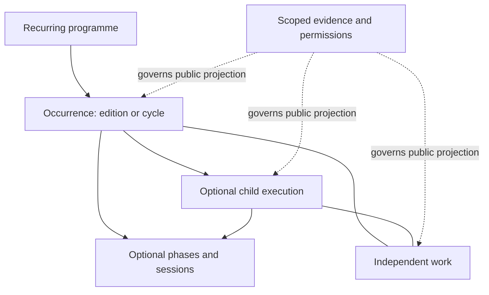

# Part C — Smallest coherent managed-content model

All structures below are **recommendations pending approval**, not canonical TypeScript edits or SQL tables.

## Taxonomy and identity

| Concept | Meaning and authoring responsibility | Example / boundary |
| --- | --- | --- |
| Programme / recurring series | Reusable purpose, audience context, default content guide, name/aliases | TE, PD; recommend BATAFIA. Kawi/schools may use series only after naming confirmation; no mandatory programme for one-offs |
| Occurrence | One identifiable institutional undertaking; edition/cycle label if applicable; owns summary, assertions, public revision | TE11, BATAFIA30, PD29cycle, one environmental action. “Edition” and “cycle” are programme language, not additional copies of event facts |
| Child execution | Separately documented activity with its own dates/place/evidence, under an occurrence when justified | GH29, RC29 under PD29. Programme and shared context derived via parent; no copied five-way context |
| Phase / session | Ordered, bounded part within one activity; stable local ID, own optional date/place/status/text/evidence | BATAFIAforum/field; SRDEsession; TEjourney leg. Not automatically another public detail route |
| Division / cohort / management period | Orthogonal classifications, references, not compulsory event parents | Multiple cohorts may participate; cycle may span management periods; one division may be absent |
| Work | Independently identifiable article, resource, periodical, documentary reference | Many-to-many activity links with role. A planned output is an intention until identity/existence verified |
| Source / evidence use | Restricted original/version and scoped evidence for specific assertion/section/relation | One LPJ supports many records; one record uses many reports; source correction review is not overwrite |
| Media asset / contextual use | Asset identity and creator/privacy/credit basis; separate approved placement | Existing six assets/eleven uses unchanged; no approval inheritance through a new parent |

Recommend one occurrence identity in the authoring experience. A TE edition and its expedition are managed on one screen and share one set of facts. Existing `te11` remains the public activity identity; `te11-edition` remains an alias/context reference during migration. Whether SQL stores edition metadata separately is a later implementation choice.

A PD cycle can own shared purpose, cohort context and applicable preparation information, while its child executions retain existing IDs and individual source assertions. This is a **new sourced parent proposal**, unlike a virtual label grouping. Source records explicitly name PDXXVI–XXIX as undertakings. Do not assert that all teams held one joint physical preparation session merely because the report groups their preparation.

## Common fields and validation by action

| Field | Save draft | Submit / publish sparse archival record | Public behavior |
| --- | --- | --- | --- |
| Stable ID + working title | Required; generated ID, rename-safe | Unique identity and duplicate check | ID stays stable when title/slug changes |
| Classification + programme/parent | Classification may start unknown; programme/parent optional | Resolve contradictory classification; check cycles/self-parenting | Independent activity gets no invented breadcrumb parent |
| Public title + summary | May be incomplete | Nonempty identity and short supported orientation required | Full title, concise intro; no boilerplate invented to fill a section |
| Dates / places | Optional typed assertions | Explicit unknown permitted; conflicts need presentation decision | Exact/range/month/year/approximate/unknown; planned and execution labels separated |
| Sources and source uses | May be pending | At least identifiable evidence or explicitly attributed testimony, reviewer acceptance of public claim | Safe bibliographic disclosure; never private locator/original by default |
| Event state | Unknown allowed | State must not imply execution from a plan/budget | Planned/ongoing/completed/unknown independent of publishing |
| Editorial revision / website state | Draft by default | Approved exact public revision + authorized publisher | Saving is not publishing; withheld work/media remains withheld |
| Programme, cohort, division, phases, results, photos, works | All optional | Required only if the selected claim/relationship needs them | Empty sections omitted; no mandatory gallery/outcome/cohort |

Unknown dates and locations need no fake day or “-” value. Add a short evidence gap when useful, not a universal legalistic warning.

## Optional repeatable content tools

A small guided set, not a page builder:

- **Objectives:** short intended aims, source references; never rendered as results automatically.
- **Phases / sessions:** title, type (preparation/forum/field/journey/reporting/other), sequence, optional planned date, actual date assertions, places, execution state, public summary, evidence. Add/reorder with buttons as well as drag; allow same-day sessions and unknown dates. At most phase→session in this proposal; no unlimited nesting.
- **Narrative:** heading + paragraphs, evidence and editorial status. Embedded ordinary paragraphs; no arbitrary layout HTML or author-selected UI components.
- **Learning/topics:** topic, whether planned/taught/applied/reported, supporting evidence, optional linked resource. Existing historical standards stay “documented standard” unless application is evidenced.
- **Observations/results:** reported observation or documented outcome, evidence, optional objective/topic reference, caveat and reviewer state. No required numeric achievement or certification checkbox.
- **Works / media:** pick existing identity, define relationship/use and location in allowed content pattern; create a separately reviewed work only when its independent identity is established.

Promote a phase to a child activity only when independent reporting, discovery or editorial lifecycle warrants it. Do not create a standalone page for each TE overnight stop or BATAFIA forum. A cross-programme joint undertaking should use an evidenced related-activity role, not two structural parents or a duplicated record. Parent graph remains shallow and acyclic.

## Field presets, not compulsory workflows

TE suggests objectives, preparation, journey, observations and works. BATAFIA suggests forum/field, sessions/topics and documented educational implementation. PDcycle suggests shared context and divisional execution list; a division suggests simulations, application and reporting. Simple activity starts with identity/summary/date/place/evidence. Historical import starts with uncertainty/source comparison. Editors may omit irrelevant tools; presets do not fabricate missing stages or impose five universal steps.

## Reuse, inheritance and revision

Shared cycle purpose/cohort display is resolved from one parent reference, with provenance of the inherited context visible to editors. Child title, dates, locations, execution, report state and results never inherit silently. An override is an explicit sourced assertion, not an unnoticed copy. Corrections to the shared record invalidate dependent previews for review; do not silently replace already approved public claims.

A source can contribute an activity narrative and several independently edited learning works. Link each work to that source version and the activity; do not republish a theory chapter or assume its third-party diagrams are cleared. Applied GH26 navigation is an activity account; a general navigation lesson is a separate resource candidate requiring technical/editorial and rights review.

Public projection evaluates record/revision approval, related-record visibility, original availability and exact media use independently. Withdrawing one use removes only that placement; global asset rights withdrawal removes all dependent uses. Withdrawing a parent suppresses that parent and inherited discovery; otherwise approved child pages remain independently accessible with a neutral return path, unless their own facts/rights depend on the withdrawn content. Publisher must see and review that impact list.

## Conceptual relationships (not a physical schema)

A source/document is not shown as an activity parent. Division and cohort are optional contextual references on occurrences/executions. Public media requires its own exact use authorization in addition to any activity relationship. The shared content tools above describe authoring responsibilities, not generic nested pages.
