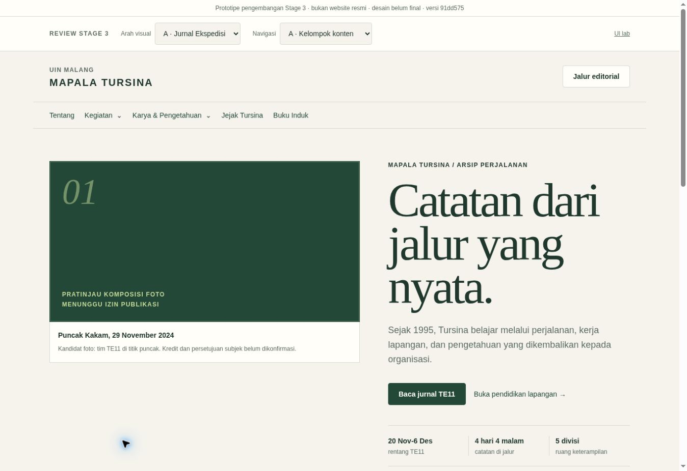
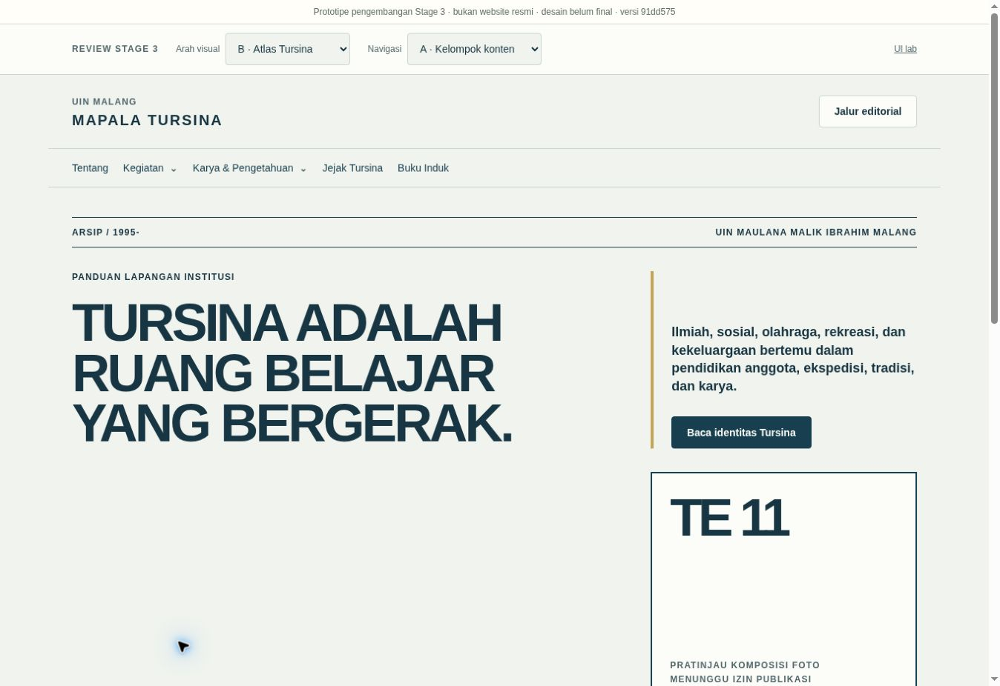
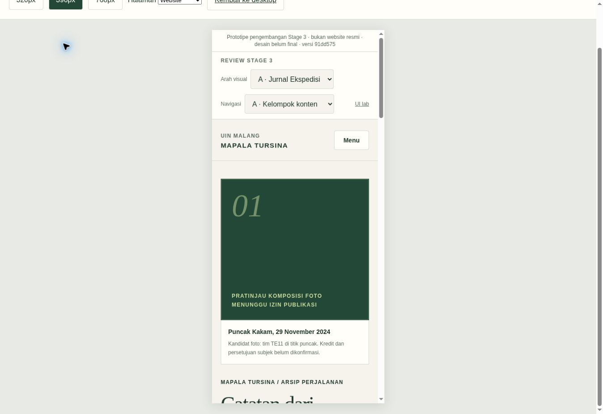
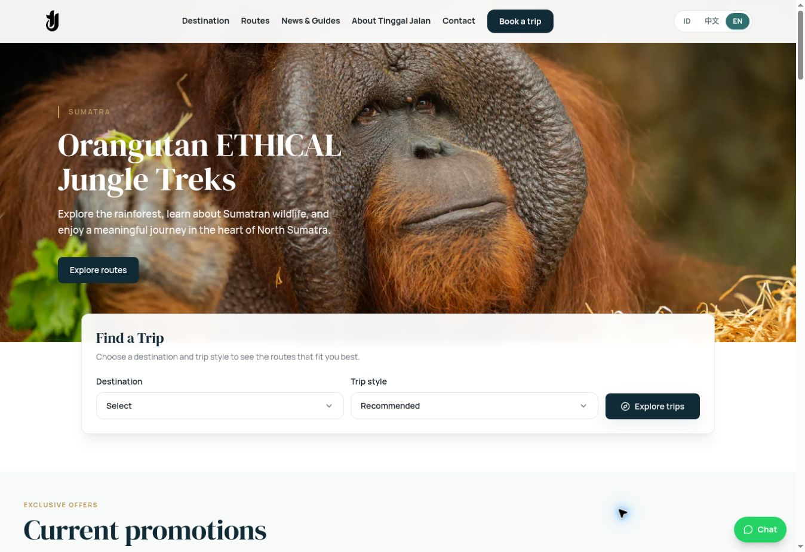
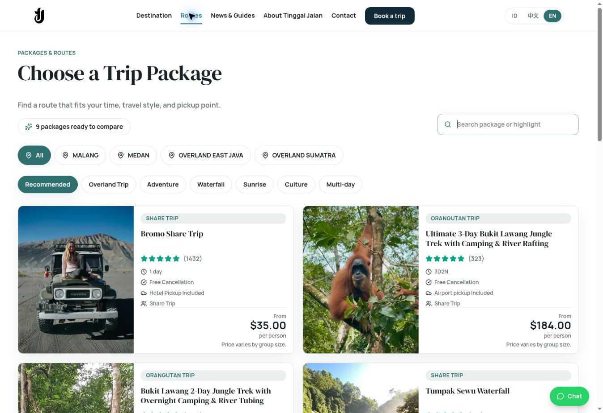

# Stage 3 recovery — Step 1 UI/UX reference study

14 October 2026 · owner review required · research only

The approved information architecture is worth retaining. The current visual treatments are rejected as final designs. The main failure is communication: the homepage presents an expedition-led editorial experiment before clearly explaining the student institution, its university affiliation and the breadth of its work. More photographs alone will not solve that problem.

Review the [reference gallery](reference-gallery.md), [homepage requirements and decision record](requirements-and-decisions.md), and the evidence below. No final theme is selected and Step 2 is not authorized by this document.

## Evidence and limits

- Repository branch reviewed at `61ade2bc06bf49f94303c22612be3c79044e25f6`; Pages renders frontend `91dd575f5cd1185e8fe3324fe9fd8903d3df6597`.
- Read `AGENTS.md`, approval record, checkpoints 01–05, design system, fixture ledger, navigation comparison, current `ArchiveDesigns.tsx`, `SitePrototype.tsx`, shared components and `theme.css`; reviewed retained screenshots and freshly rendered public home A/B.
- TinggalJalan `main` reviewed at `627978e8114683c284c394499bbf1cdc2bcced26`. Source inspection and public browser rendering are separately identified below; no claim that every live asset matches that exact repository commit.
- Six primary external references were browser-inspected, plus one Indonesian outdoor-organization comparator. Screenshots are actual public-page captures at a 1363×936 desktop browser viewport, not generated mockups. Sites' content and animation state may change.
- Tursina's existing responsive harness was inspected at a 390px frame. External mobile viewport inspection was unavailable: the supported browser API exposes no viewport-resizing/touch-emulation method. Responsive code was inspected for TinggalJalan; that is not a rendered-mobile validation claim.
- This is an expert heuristic review, not a measured five-second user study, accessibility certification or conversion study. No fabricated task-success scores or participant responses.
- The private 17-page photographic review package and its shortlist ledger were reread. Exact private locators and contact sheets are not copied into this public research folder.

## Current prototype assessment

| Area | Concrete finding | What to preserve / implication |
|---|---|---|
| First impression | A leads with an abstract field-notes headline; B describes a moving learning space. Neither foregrounds “Mahasiswa Pencinta Alam” or explains that Tursina is a university student organization. | Put the literal identity before editorial language. A newcomer should not need Tentang to understand the site. |
| Institutional identity | The header has a small UIN Malang label and plain text wordmark. No verified official logo is embedded. Meaningful green/blue/gold research exists, but the chosen colors and system-font stacks do not by themselves express institutional character. | Preserve the verified identity basis. Request a specific official asset/use decision; do not invent a crest or make color interpretation an official specification. |
| Hierarchy | The release strip, selectors, lab link, institutional header and navigation consume the top portion. The editorial simulation receives a prominent header control. | Review tools are useful development infrastructure, but should not dominate a visitor-facing design review. Test the actual public composition separately in Step 2. |
| Homepage composition | A includes TE11 hero, TE11 chronology, then PD. B introduces an abstract identity, an index dominated by TE/PD, then conceptual principles. Independent stories, publications and broader institutional life are absent from both home bodies. | Retain programme-centered discovery; restore a balanced institutional overview rather than making the homepage a partial expedition detail page. |
| Photography | Huge dark/light plates consume visual attention without showing people, field practices or place. They accurately signal rights HOLD but cannot demonstrate the intended photographic hierarchy. | Placeholders are a clearance boundary, not a loading limitation. Evaluate approved real compositions before selecting a direction. |
| Navigation | Canonical routes and programme/edition relationships work. A hides TE/PD in a general group; B exposes TE directly but leaves institutional introduction less visible. Acronyms and edition numbers presume familiarity. | Preserve routes and current relationship model. Strengthen labels and visible homepage entry points; do not reopen the sitemap. No new visitor testing proves A or B superior yet. |
| Component hierarchy | Buttons, status labels and activity cards are reusable. `ArchiveDesigns.tsx` contains substantial page-specific markup; home/story/dossier headings each get their own scale, and source notes compete with visitor information. PD detail A/B largely shares composition and changes type/color. | A design system needs a hierarchy of content roles, not merely a central CSS file. Centralize approved heading/metadata/media patterns in Step 2; keep truly special editorial layouts deliberate. |
| Content presentation | Verified sparse records, historical states, uncertainty and related-publication returns are valuable. Yet the homepage repeatedly foregrounds evidence/permission status and one expedition's logistics before the visitor understands the organization. | Preserve provenance and sparse/rich handling. Make the readable summary primary; place source/uncertainty detail in a secondary disclosure where appropriate. Do not hide material uncertainty. |
| Mobile experience | In the 390px frame, A's main heading begins at approximately y=824px. Review chrome, header and the first media plate precede it. No horizontal overflow does not imply an effective mobile first impression. | Mobile must prioritize identity, explanation and an action before large media or development controls. Recompose; do not merely shrink the desktop design. |

## Structural successes retained

Programme identities and individually identifiable editions; canonical expedition–publication links; PD division/cohort filters; standalone activities; independent publications; Jejak; simple synthetic NIA/name catalogue; sparse records without invented narrative; local organizer/editor/publisher demonstration; shared tokens and controls; safe Pages output and hash routes. The owner accepts their usefulness. None needs an unrelated redesign during recovery.

## TinggalJalan benchmark

Public views: [homepage](https://tinggaljalan.com/) and [catalogue](https://tinggaljalan.com/routes). Screenshots show the active hero slide at capture time, not all carousel states. Browser journey from navigation to catalogue was observed; this study did not submit a booking, contact message or payment.

| What works | Source/rendered evidence | Transfer to Tursina |
|---|---|---|
| Task-oriented sequence | `HomePage.jsx`: hero → promotions → destinations → featured routes → trust/stories → guides → FAQ → final action. Rendered trip finder connects directly to the catalogue. | Define each section's visitor question and next step. Replace booking/price conversion with learning about Tursina, discovering programmes and reading work. |
| Photographic focus | `Hero.jsx`: distinct mobile/desktop image inputs, configurable focal position/overlay and defined dimensions. Rendered hero retains a clear subject behind controlled text. | Review crops and focal points with real cleared Tursina assets; don't cover the climber/belay system with copy. A single strong image is sufficient; a carousel is not required. |
| Controlled hierarchy | `app.css`: Manrope + DM Serif Display, semantic colors, shared container/section styles, distinct hero/section/card/copy scales. `SectionHeader` uses a consistent title/deck relationship. | Approve a type and spacing hierarchy through references first. Reuse roles across pages; do not copy these fonts or palette automatically. |
| Reusable layers | `AppLayout` owns navbar/footer/consent; `components/sections` owns content compositions; `components/ui` owns controls, image, headings and galleries; shared `styles.js` supplies interactive states. | Separate shell, content sections and primitives. A small component catalogue should embody the chosen visual grammar. |
| Responsive media discipline | `ResponsiveImage` uses picture sources, WebP srcsets, sizes, intrinsic dimensions and loading priority. Browser DOM confirmed eager first hero and lazy subsequent images, with picture sources present. | Use a permission-aware media record feeding approved derivatives, alt, caption, credit and focal crop. Performance planning is a transferable principle, not permission to publish originals. |
| Interaction feedback | Catalogue has explicit search/category/style controls and comparable decision fields. `useSlider` supports keyboard/swipe, focus/hover pause and reduced motion. | Clear filters and feedback matter. Copy no ratings, pricing, cancellation badges or tourism vocabulary into activity records. |

Responsive source evidence: `Navbar.jsx` switches to a mobile disclosure below the large breakpoint and closes it on link navigation; `Hero.jsx` changes text placement/spacing and supplies separate mobile image inputs; `ResponsiveImage` selects desktop sources at 640px. These are deliberate responsive rules, not proof of mobile rendering in this research session. Menu semantics and physical-device behavior still need independent verification before using them as accessibility examples.

TinggalJalan is not an unquestionable template. Its active promotional slide can displace the company introduction; some live copy/metadata are lengthy or linguistically inconsistent. Displayed trust claims were not independently audited here. A hidden H1 and rotating messages do not substitute for a stable visible institutional introduction. The transferable advantage is a coordinated system of purpose, media, hierarchy and action—not ornamental similarity or more rounded cards.

Source links: [HomePage](https://github.com/fairusinampratama/tinggaljalan/blob/627978e8114683c284c394499bbf1cdc2bcced26/resources/js/pages/HomePage.jsx), [Hero](https://github.com/fairusinampratama/tinggaljalan/blob/627978e8114683c284c394499bbf1cdc2bcced26/resources/js/components/sections/Hero.jsx), [theme](https://github.com/fairusinampratama/tinggaljalan/blob/627978e8114683c284c394499bbf1cdc2bcced26/resources/css/app.css), [ResponsiveImage](https://github.com/fairusinampratama/tinggaljalan/blob/627978e8114683c284c394499bbf1cdc2bcced26/resources/js/components/ui/ResponsiveImage.jsx), [shared controls](https://github.com/fairusinampratama/tinggaljalan/blob/627978e8114683c284c394499bbf1cdc2bcced26/resources/js/components/ui/styles.js), [slider](https://github.com/fairusinampratama/tinggaljalan/blob/627978e8114683c284c394499bbf1cdc2bcced26/resources/js/hooks/useSlider.js).

## Synthesis for owner review

The strongest foundation is **explicit institutional introduction + authentic field people/practice + programme discovery + editorial depth**. NOLS informs education clarity, RGS informs institutional fieldwork, Cambridge informs identity/audience signposts, Emergence informs reading/attribution, Rijksmuseum informs collection discovery, and Surfrider informs programme/community relationships. Wanadri supplies a local cultural comparator, with limitations noted in the gallery.

These are recommended reference roles, not an approved combined theme. Read [requirements-and-decisions.md](requirements-and-decisions.md) before approving the research basis. A separate Step 2 authorization is required.
