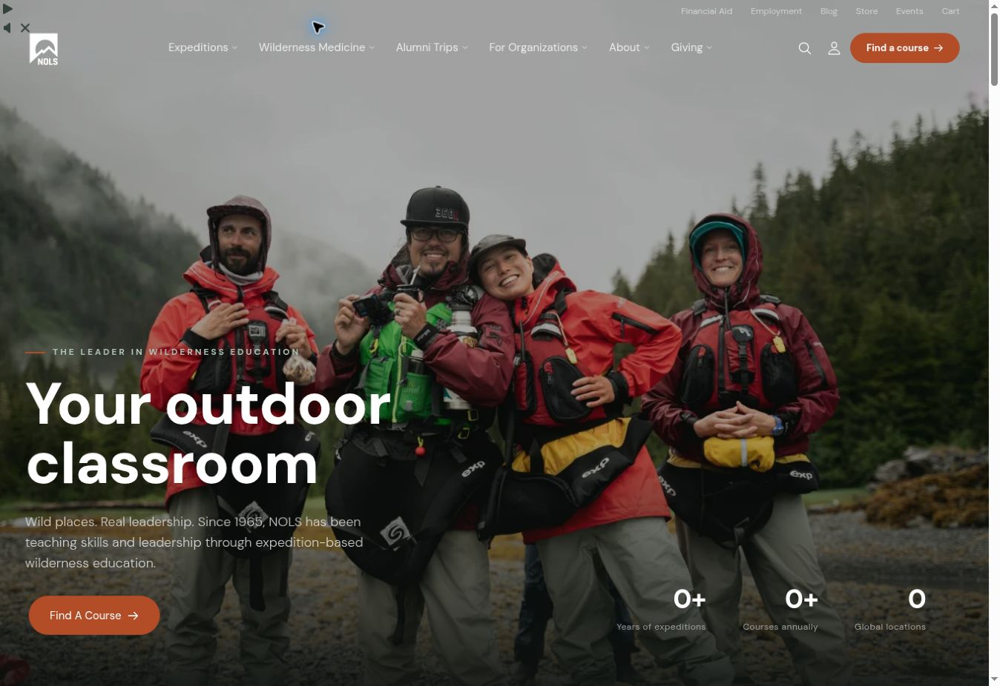
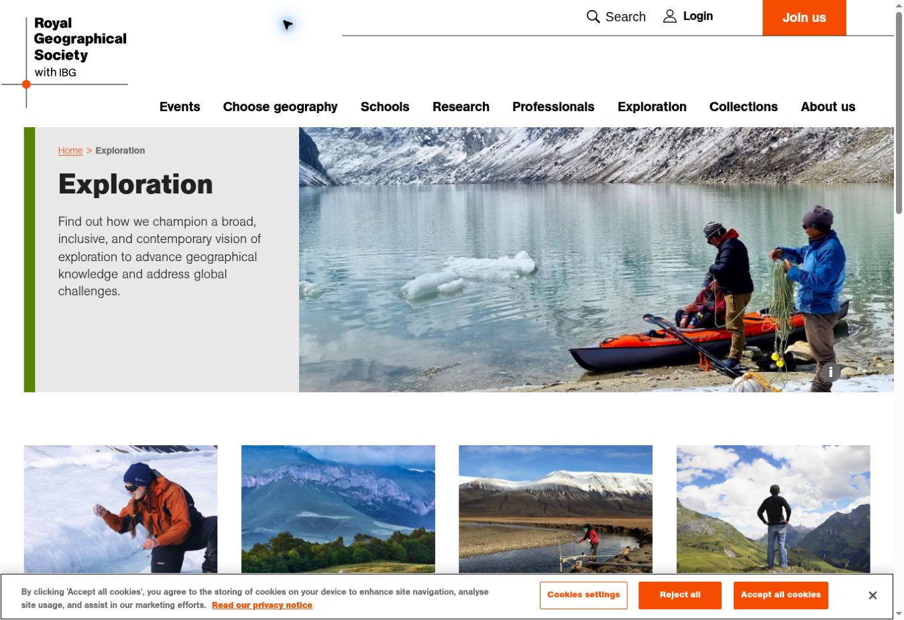
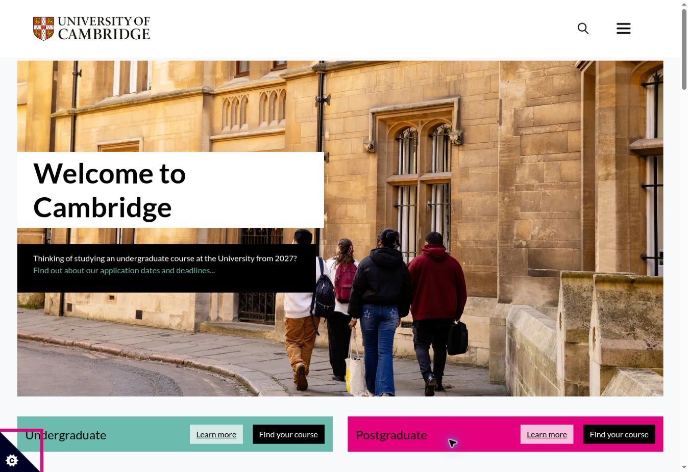
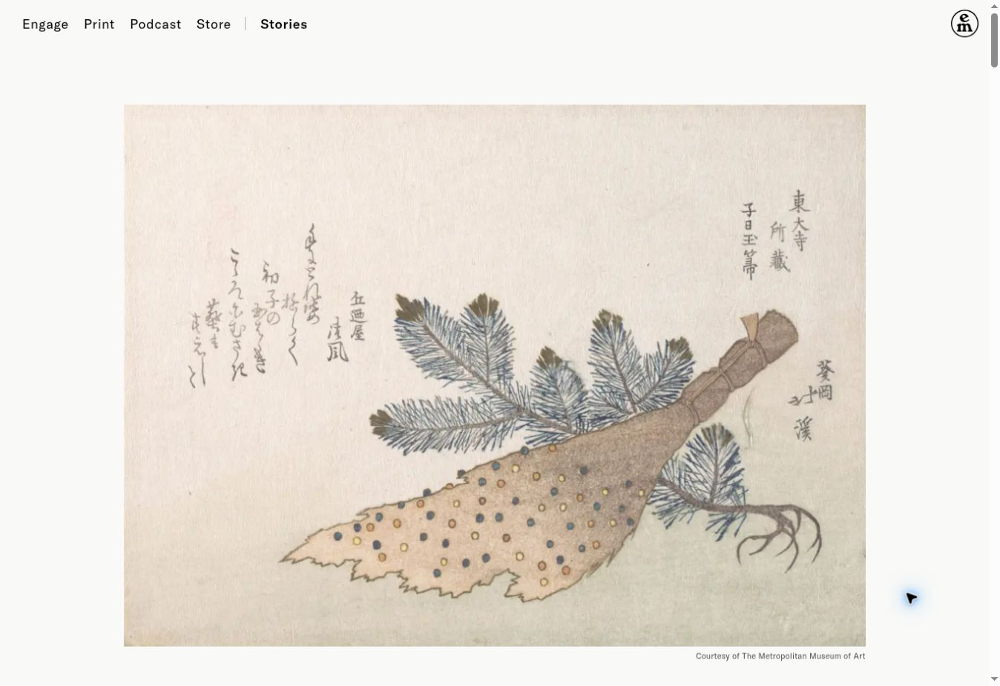
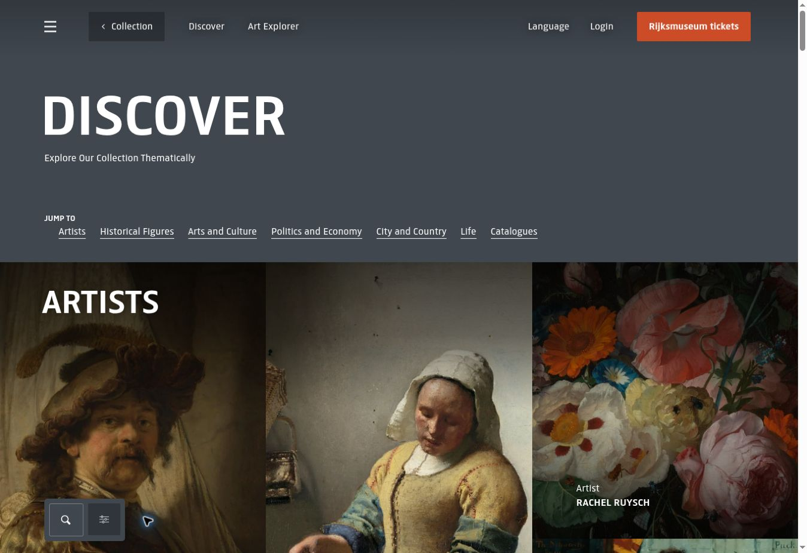
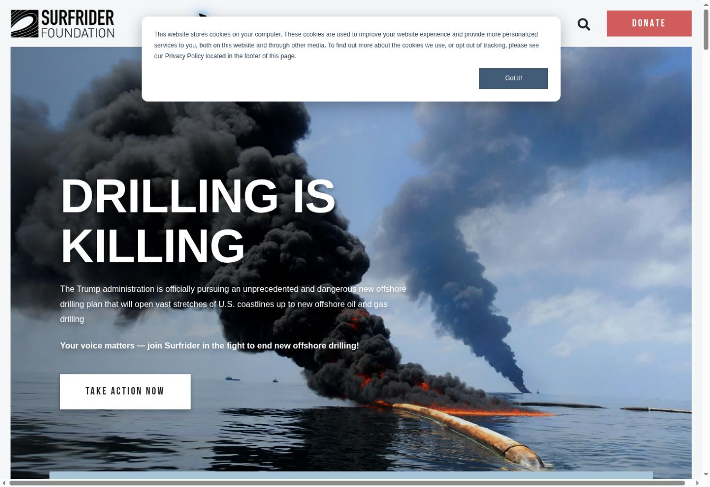
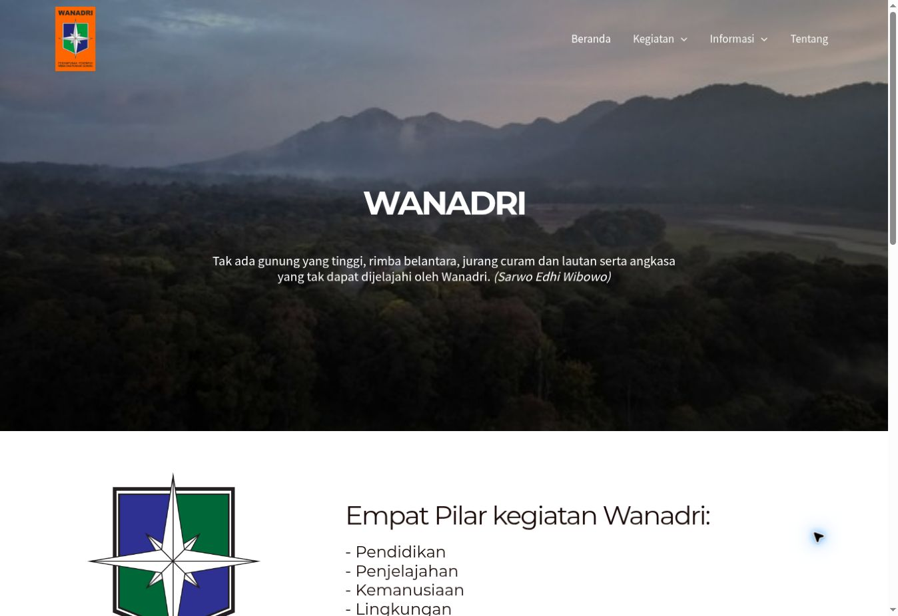

# Rendered reference gallery

14 October 2026 · research evidence, not a selected theme

Six primary references plus one local comparator. Each image is an actual desktop browser capture, not a moodboard or generated design. External mobile rendering was not verified; the available browser surface had no viewport-resize API. Do not infer a site's mobile quality from a desktop screenshot. Original websites retain their text, image, identity and design rights; these captures are bounded study evidence, not reusable Tursina assets.

## 01 — NOLS: outdoor education made legible

URL: https://www.nols.edu/  
Observed section: homepage introduction and course pathways.

**Immediate communication:** an education organization teaching through outdoor expeditions. A literal category label explains the more expressive headline, while people with field equipment establish the activity.

**Composition/type:** one dominant photographic scene, bold sans headline, short explanatory deck and a contrasting course action. Utility links and programme navigation have separate roles. Photography depicts a group rather than treating the wilderness as an empty product.

**Discovery/interaction:** expeditions, wilderness medicine and alumni trips are distinct entry points; the course-finder action has priority. The capture showed video controls and zero-value counters during initialization; these are observed rendering states, not verified institutional totals.

**Tursina lesson:** connect education and field activity in a literal introduction; use members doing something relevant. Name the education pathway in accessible language.

**Do not copy:** commercial course funnel, global scale claims, animated counters or a heavy video requirement. Technical delays must not obscure essential identity.

## 02 — Royal Geographical Society: fieldwork with institutional authority

URL: https://www.rgs.org/exploration  
Observed section: exploration landing-page introduction and resource cards.

**Immediate communication:** exploration supports knowledge and field practice within an established institution.

**Composition/type:** explicit page title and explanatory text occupy a solid panel beside a documentary fieldwork image. Black sans hierarchy and a restrained accent make the purpose readable without placing all copy on a photograph. The image shows people operating equipment, not simply a dramatic landscape.

**Discovery/interaction:** breadcrumbs establish location; cards distinguish explanation, practical support, grants, education and community. The header separates organizational functions and utilities. A cookie banner is visible in the capture.

**Tursina lesson:** a PD or programme overview can combine identity, practical purpose and evidence before exposing deeper records. Photograph the practice—map work, belay, observation—not only the outcome.

**Do not copy:** its large professional taxonomy, grants machinery, expansive mega-menu or institutional status. Tursina needs a smaller public system with equivalent clarity.

## 03 — Cambridge: unmistakable identity and visitor signposts

URL: https://www.cam.ac.uk/  
Observed sections: homepage opening, audience signposts and expanded menu.

**Immediate communication:** the university name/crest, campus and students make the institution clear before the visitor reads detailed copy.

**Composition/type:** a simple heading panel overlaps a large contextual image; a separate information strip leads to an immediate task. Strong blocks and whitespace establish hierarchy. The photograph combines people and university place, providing identity through context.

**Discovery/interaction:** audience signposts sit directly below the opening. The Menu control was opened and showed study, research, news, alumni and institutional routes. This prevents the homepage from becoming a complete administrative index.

**Tursina lesson:** place the official Tursina identity and UIN affiliation where they can be recognized immediately; offer useful signposts without replacing programme-centered navigation with audiences.

**Do not copy:** crest treatment, university-scale admissions hierarchy, palette, or hiding all major routes inside a desktop menu. Tursina is a student organization, not the whole university.

## 04 — Emergence Magazine: editorial evidence, attribution and reading

URLs: https://emergencemagazine.org/ and https://emergencemagazine.org/essay/new-life-for-the-ezo-spruce/  
Observed sections: homepage feature/index, essay opening and reading column.

**Immediate communication:** a publication focused on reflective stories about living environments. The essay pairs an image with visible credit, title, author/translator and date rather than confusing the essay with an expedition record.

**Composition/type:** restrained navigation, generous image space and a narrow serif reading column create an authored reading experience. Image attribution is part of the composition. The homepage separates reading, listening and watching; publication format is a meaningful discovery dimension.

**Interaction:** related works and contributor information are present. The homepage's feature action was unreliable in this session and some early frames were visually sparse; the directly opened essay rendered successfully.

**Tursina lesson:** articles need authorship, evidence, readable measure and contextual media; preserve their links to canonical activities without duplicating them.

**Do not copy:** the magazine's cosmology, slow immersive transitions, low-contrast overlay or oversized atmospheric opening as the institution's first explanation. Documentary pages can be expressive after the homepage is clear.

## 05 — Rijksmuseum: multiple ways into one collection

URL: https://www.rijksmuseum.nl/en/collection/discover  
Observed section: thematic collection discovery and search/filter controls.

**Immediate communication:** this is a collection to explore, with thematic pathways rather than a raw file listing.

**Composition/type:** a high-contrast title and clear thematic jump links precede large image-based collection entries. The artwork is the primary evidence; labels give it a discovery role. Navigation and content have a consistent visual separation.

**Discovery/interaction:** thematic browsing, Art Explorer and search/filter entry points coexist. Themes span people, cultural categories and history, so one record can be reached through meaningful contexts.

**Tursina lesson:** Jejak, publications and activity collections can provide curated entry points while preserving canonical identities. Catalogue metadata should help discovery, not appear as administrative filler.

**Do not copy:** museum-scale taxonomy, full-bleed artwork grids as every page's layout, account features, expensive exploration tools or an implied right to reuse archive media. Tursina should curate small useful sets first.

## 06 — Surfrider: mission, programmes and community action

URL: https://www.surfrider.org/  
Observed sections: campaign opening, mission, programme/campaign distinction and community pathway.

**Immediate communication:** an environmental advocacy organization asking visitors to act on a specific issue.

**Composition/type:** emphatic sans headlines, a relevant campaign photograph and a strong action hierarchy communicate urgency. Subsequent sections distinguish mission, current news, campaigns, programmes and volunteer community. The capture contains a cookie notice and an unusually wide page state; it is not evidence of perfect responsiveness.

**Discovery/interaction:** learn, involvement and giving have different roles; a local-community selector offers an explicit participation pathway. No donation or form submission was performed.

**Tursina lesson:** explain how activities, education and community belong to one mission. Distinguish recurring programme identities from individual activity editions and works.

**Do not copy:** campaigning tone, donation-first navigation, impact counters, political claims or participation features without approved operational channels. A campaign-led hero would reproduce Tursina's problem if it displaced the institutional introduction.

## 07 — Wanadri: local identity comparator

URL: https://wanadri.or.id/  
Observed section: homepage, identity and four activity pillars.

Included for Indonesian outdoor-organizational relevance, not as a universal quality benchmark.

**Immediate communication:** an established outdoor association, recognizable through its emblem, name and landscape. Its activity pillars quickly establish that outdoor work includes education, exploration, humanitarian activity and environment.

**Composition/type:** a scenic introduction followed by an emblem and plain activity list connects institutional identity to work. Navigation stays small. The long values text that follows is more suitable for deep institutional reading than quick discovery.

**Tursina lesson:** actual emblem, institutional traditions and named activity purposes matter more than invented decorative motifs. A concise overview can introduce breadth before detailed archives.

**Do not copy:** its slogan, emblem, values, landscape-as-identity shortcut or dense homepage text. The opening still assumes familiarity with the name; Tursina must explicitly explain its student identity and affiliation.

## Excluded / limited evidence

Sidetracked's online edition archive was searched and opened, but a Cloudflare security-verification screen remained after one ordinary reload. It is not counted as a rendered reference and no visual claims are made from search snippets. No bypass was attempted. See [browser restriction guidance](https://help.openai.com/articles/20001280-using-cloud-browser-in-chatgpt#when-a-website-blocks-the-task).

External screenshot evidence covers desktop only. In Step 2, mobile treatments must be separately composed and tested; this gallery does not approve any site's responsive implementation as a copy target.

## Recommended reference roles — pending owner review

| Problem | Primary reference role | Boundary |
|---|---|---|
| Explain Tursina and outdoor education immediately | NOLS + Cambridge | Literal student/university identity; no course-commerce or admissions copy |
| Communicate serious field practice | RGS | Documentary people/equipment; smaller taxonomy |
| Read a rich expedition or publication | Emergence | Reading rhythm and attribution; retain canonical activity metadata |
| Discover accumulated institutional work | Rijksmuseum | Curated pathways; no premature giant archive interface |
| Connect programme, activity and community | Surfrider + local Wanadri context | No campaign/donation funnel or borrowed institutional values |

This selects analytical roles for discussion, not an art direction or visual specification. Step 2 remains separately authorized.
