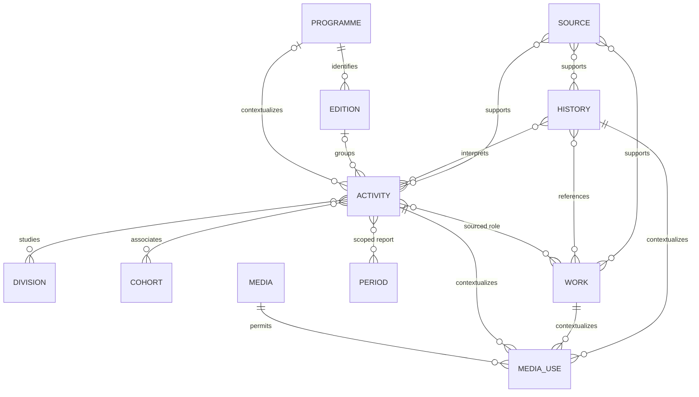

# Database-readiness handoff — no persistence implementation

This is a domain-derived proposal, not approved SQL or a one-TypeScript-type-per-table mandate.

## Conceptual relationships

A media use has one content context, not three compulsory owners; the diagram shows alternative context families. Source uses also support assertions/relations/media/institutional blocks. Activity↔activity contextual edges and independent synthetic-member demonstration are omitted from this diagram to keep it legible. Cardinalities describe validated capability; not every combination is populated with real evidence.

## Verified requirements versus design recommendations

| Domain evidence | Verified requirement | Candidate storage/editing recommendation | Open decision |
| --- | --- | --- | --- |
| TE10–12, PDXXVI–XXIX and independent activities | Stable activity identity independent of title, route, management period or cohort. Programme optional. | Activity entity; programme/edition context references; field/cohort join relations if needed. Preserve current IDs as import keys even if internal numeric keys are used. | Final ID/slug policy and ID collision namespace; no `(programme,cohort,division)` universal uniqueness. |
| TE11 unexecuted2023–24 then executed2024–25 | Period-scoped report assertions coexist with later execution. | Small assertion/period relationship; keep execution state distinct from source statements/planned dates. | Whether organizational periods need separately managed records beyond sourced labels. No leadership roster implied. |
| RC/Caving26 shared departure with27 | Several cohorts may have related but distinct occurrences. | Sourced role-aware activity relation; composite unique endpoints+role; no self-reference; intentional deletion/withdrawal policy. | Controlled role labels and reciprocal display wording. |
| TE11's four works; independent design deck/magazine | Work independent; activity↔work many-to-many with meaning. | One work identity plus relationship table with role/evidence. Work body and resource metadata optional; periodical distinguished. | Editorial title versus original title, final news/type taxonomy and richer reusable-body vocabulary. |
| TE11 end-date/province conflict; ORAD/LH27 lines | Multiple evidence assertions; precision and uncertainty survive import/correction. | Typed date precision + optional range/approximation and assertion/source associations. Public chosen label separate from asserted value. | SQL date/year/month storage and uncertain-date query bounds; no invented day01 as a fact. |
| LPJs support many activities, one activity uses several sources | Sources and source uses have separate identity/custody; report text is not proof of ratification. | Source identity/version/checksum in restricted custody; safe bibliographic projection, per-use page/claim reference. | Custodian, source master/version authority and retention; no public original download presumed. |
| Five HOLD photo usages | Rights, privacy, credit, scope approval, derivative and withdrawal all matter. | Asset identity + contextual usage/permission records; fail-closed public projection; derivative allowlist/hash separately verified. | Actual creators/consent/approved uses and media licensing evidence remain asset-specific. |
| Selected8history entries, gaps between1995 and2022 | Institutional history has its own interpretation/identity, not every year/period/member. | History entries with sourced precision, relations and explicit coverage limitations; unknown-date group later. | Whether a period narrative merits a standalone public story, and correction standards for disputed memories. |
| Synthetic NIA/name only | Real disclosure cannot follow from schema capability. | Keep future restricted operational membership distinct from a separately authorized minimal public projection. Uniqueness/correction/withdrawal required if real data is later approved. | Lawful basis, actual public subset, custodian and objection/correction process; no real data authorized now. |

## Integrity, publication and revisions

Recommend unique stable public/import IDs, programme+edition-label uniqueness where label identity is established, referential foreign keys and unique role-aware edge tuples. Do not enforce unique date/location/cohort combinations: shared departures demonstrate why that would merge distinct records. Unknown fields remain nullable/absent; minimum publication requirements vary by metadata-only, sparse, rich and original-availability modes.

Editors should deduplicate records, attach evidence, classify programme/field/cohort, distinguish planned/actual/source dates, write approved public summaries, select relationships and flag contradictions. Publisher checks exact public projection and media permissions; custodian controls originals. Organizer supplies information through the approved simple intake arrangement; no compulsory CMS account. Named appointments, live authorization and actual workflow implementation are still open.

Before persistence, define a modest revision record (content ID, revision ID, editor, time, reason, affected assertions/relations and approved public snapshot). Corrections should preserve superseded evidence and explain the selected display; withdrawal removes public snapshots/search/derivatives and invalidates usages while retaining appropriately restricted audit history. This recommends revisions, not event sourcing or a generic graph engine.

## Queries and migration

Required demonstrated queries: programme/edition discovery, PD field∩cohort filters, independent activities, work type/keyword search, work→all activities, activity→all works, source-use audit, chronological selected history with unknown/approximate cases, quality/conflict/restriction report, synthetic NIA/name search. Broader search indexing, pagination and query tuning need real volume/task evidence.

Import in dependency order: source identities and contextual definitions → activity/work/history identities → assertions/narratives → sourced relations → reviewed media usages → authorized public projections. Preserve existing stable IDs and aliases/URLs. Stage source candidates separately; validate and review before projection; do not derive records from every filename, target, budget line or participant row. Use repeatable export/validation, dry runs and duplicate/reference reports. Keep restricted originals and public imports separate. No migrations, ORM, APIs, Filament, persistence or production changes are included.

## Bounded sampling limitation

PengenalanDivisiXXVIII in DraftLPJ2024–2025 pp77–78 is a candidate with separate forum/field dates and places across all five fields. It is not silently renamed PD or split into five invented parent activities. TE11 already demonstrates scoped dated journey legs. Before importing more composite activities, confirm how generic dated phases/chapters should be authored: distinct phase dates must not be treated as conflicting assertions about one overall execution date. This is an evidence-backed extension question, not a reason to require a universal phase table now.
